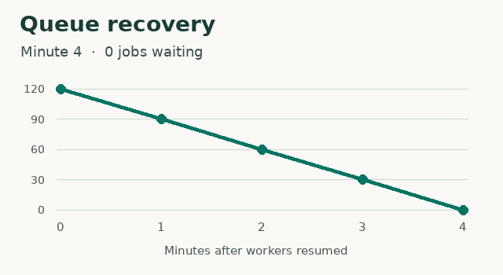
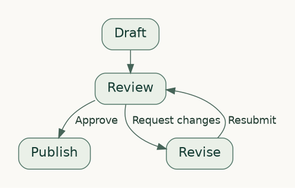

# Media lab

Edit the examples here and compare the source with the preview. The images and clip are bundled with the course. Their relative paths also work in the repository.

## Describe the information in a chart

The sample queue emptied at minute four. Use the alt text to convey the trend and the surrounding paragraph for its significance. In the source, change the description to “chart”, then imagine reading only that word. Try the [chart caption exercise](../practice/chart-caption.md).

## Turn an image into a destination

The outer link opens the diagram at full size. The inner image supplies the visible control and its accessible name. Replace both occurrences of `review-cycle.png` with `release-checks.png`. Update the description to explain the new image. [Build a linked thumbnail](../practice/linked-thumbnail.md).

## Embed a clip and give readers another way to use it

<video controls src="../media/queue-recovery.webm" aria-label="Queue recovery, minute by minute"></video>

[Open the five-second clip](../media/queue-recovery.webm) · [Read the descriptive transcript](../media/queue-recovery.txt)

This silent clip advances one minute of simulated time per second. Pause after the second observation and use the transcript to check the queue depth. The Arena provides playback controls for its bundled teaching videos. A renderer can filter the HTML element and still display the ordinary Markdown links below it.

For an externally hosted video, make the thumbnail a link to the video page. For a slide deck or audio recording, give the link a descriptive title and include slides, notes or a transcript. GitHub also supports uploaded attachments in issues and pull requests. Test the published surface before promising inline playback. [GitHub attachment documentation](https://docs.github.com/en/get-started/writing-on-github/working-with-advanced-formatting/attaching-files)

[Practice an embedded video and fallback](../practice/video-embed.md).

## Experiment with the assets

| File | What it contains | Try changing |
| --- | --- | --- |
| [Queue chart](../media/queue-depth.png) | Five observations from minute zero to four | The alt text and caption for a different audience |
| [Review cycle](../media/review-cycle.png) | An approval path and a revision loop | The outer link of a clickable thumbnail |
| [Release checks](../media/release-checks.png) | A completed build and a pending review | A sentence distinguishing status from evidence |
| [Recovery clip](../media/queue-recovery.webm) | The queue chart revealed one observation at a time | The player and the separate link that survives a text-only preview |
| [Descriptive transcript](../media/queue-recovery.txt) | The measurements in reading order | Use it to rebuild a data table |

To reuse an example in another repository, copy its asset along with the Markdown and resolve the path from the new document. A link to an image opens the file. Adding an exclamation mark before the link places the image in the page.
