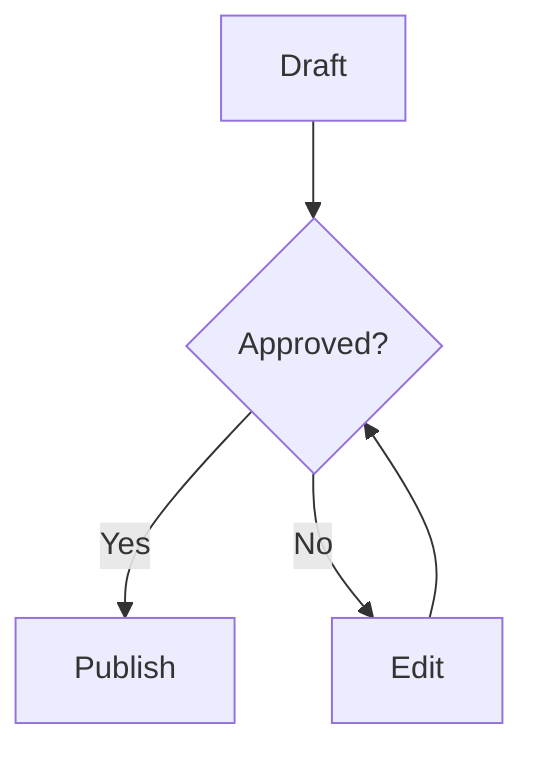
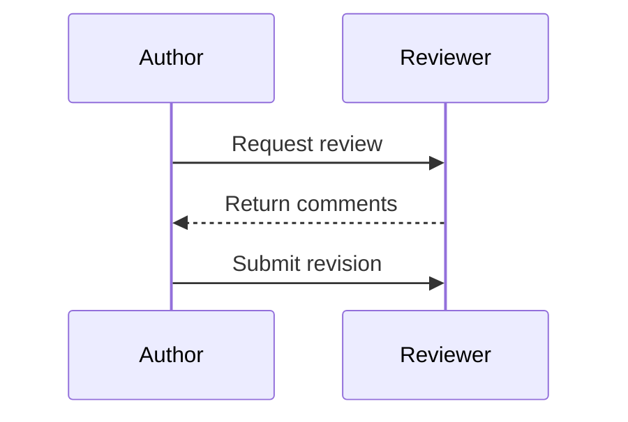
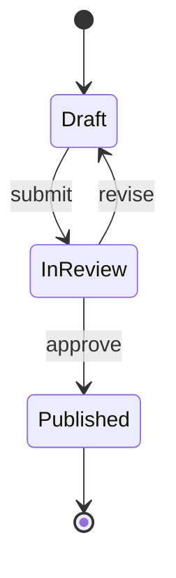
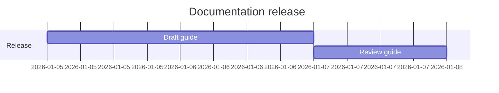

# Diagrams

Use a diagram when the relationship between steps matters. Give it a sentence that communicates the outcome even when the reader sees only a code fence.

## Show a decision with a flowchart

A release proceeds after review. A requested change sends it back for editing.

The first line selects the diagram type and direction. TD and BT lay out vertically. LR and RL lay out horizontally. Stable node IDs let you change the visible label without editing every edge. Label both sides of a decision so a reader can follow either outcome.

[Practice flowcharts](../practice/mermaid.md)

## Show message order

Read downward to follow time. Participants own the columns. Use verbs that say what the receiver learns. If understanding the process depends on who replies, a sequence diagram is easier to follow than a list of boxes.

[Practice sequence diagrams](../practice/sequence.md)

## Show valid states

A state is a condition that can persist. A transition names the event that changes it. Starting at Draft, trace a revision followed by an approval. The diagram rules out publishing directly from Draft.

[Practice state diagrams](../practice/states.md)

## Show a schedule

The second task refers to the first task's ID. Changing the duration of the draft moves the review. Use a table for exact dates that readers need to copy. Use a schedule diagram when dependencies explain the dates.

[Practice schedules](../practice/schedule.md)

## Publish for a second renderer

A fenced Mermaid block remains readable source in a CommonMark-only preview. For a large diagram, ship an image plus a text description. Use a table for exact values and a standard plot for measured trends. If you export a diagram, keep its editable source beside it so reviewers can compare revisions.

Finish with the [release README capstone](../practice/capstone.md).
