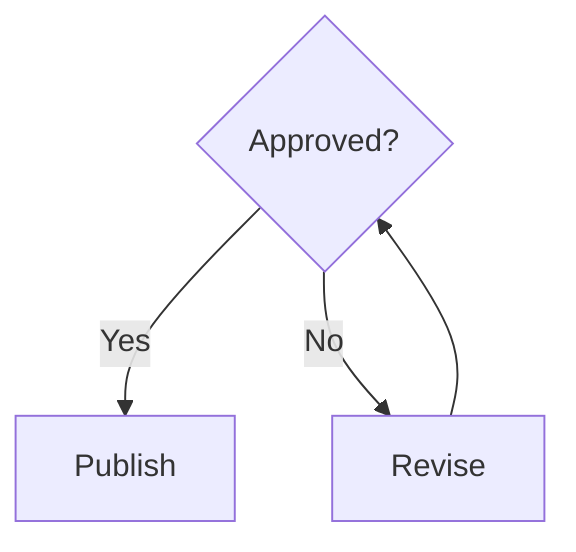

# Publish a release README

You maintain a CLI called Field Notes. Write a README that lets a first-time user run it and a reviewer decide whether to publish. Include a one-sentence purpose, ordered setup with a copyable command, an option table, a release checklist, and a review diagram with a plain-text explanation. Document what a successful run prints.

## Starter

~~~~markdown
Field Notes

Purpose

Quick start

Options

Release review
~~~~

## Hint

Start with the reader’s first successful run. Review the rendered list before adding the diagram.

## Worked solution

~~~~markdown
# Field Notes

Field Notes turns local notes into a searchable index.

## Quick start

1. Open the project directory.
2. Build the example index.

   ```sh
   field-notes index ./notes
   ```

   A successful run prints `Index ready`.

## Options

| Option | Purpose |
| --- | --- |
| `--dry-run` | List files that would be indexed |

## Release review

- [x] Run the example
- [ ] Review the output

Publish after approval. Return changes to the author for another review.


~~~~

## Self-check

Score one point for each observable result: purpose identifies the input and outcome; the steps stay ordered around the fenced command; the expected output is explicit; the option has a meaningful description; the checklist distinguishes done from pending; and both diagram outcomes are understandable with diagrams disabled. Rework any missing item, then compare your choices with the worked solution.
