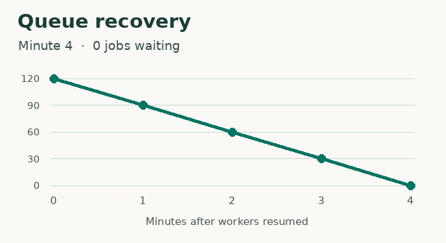

# Explain a chart with Markdown

Use the bundled chart and transcript to state what changed, give the image meaningful alt text, and write a caption that interprets the measurement.

## Starter

~~~~markdown

Add a caption.
~~~~

## Hint

The description should convey the trend. Use the caption to explain why it matters to the reader.

## Worked solution

~~~~markdown

The sample backlog drained at 30 jobs per minute. [Read the five observations](../media/queue-recovery.txt).
~~~~

## Self-check

Can someone recover the time range, endpoints and rate without seeing the chart? Follow the transcript link and verify the arithmetic.
