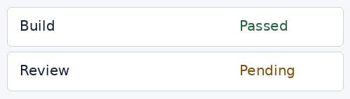

# Write an accessible linked image

The sample shows a build that passed and a review that is pending. Make the image link to its full-size file. Give readers the result in the alt text and add a separate text link.

## Starter

~~~~markdown

~~~~

## Hint

Nest the image expression inside the label of a regular link.

## Worked solution

~~~~markdown

[Open the full-size release checks](../media/release-checks.png)
~~~~

## Self-check

Both links open the same image. If images are disabled, the alt text still tells the reader which check needs attention.
