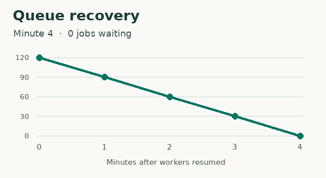

# Write an incident review

A training simulation paused workers at 09:00 UTC. By 09:04 the queue held 120 jobs. Processing resumed then, and the backlog cleared at 09:08. The cause of the pause is still under investigation. Separate measured impact, chronology, uncertainty and follow-up actions. Use the supplied chart as evidence.

## Starter

~~~~markdown
# Incident review

Workers stopped. It recovered.

Next steps
~~~~

## Hint

Choose one time zone and distinguish an observation from an inference. State which measurement would resolve an open question.

## Worked solution

~~~~markdown
# Queue processing delay

## Impact

Queued work waited for processing. The highest observed backlog was 120 jobs. The sample contains no per-user latency measurements.

| UTC | Observation |
| --- | --- |
| 09:00 | Workers paused |
| 09:04 | Workers resumed with 120 waiting jobs |
| 09:08 | Queue depth reached zero |

## Investigation

The readings establish when the queue recovered. The initiating cause remains open. Compare worker lifecycle events with configuration changes around 09:00.

## Follow-up

- [ ] Worker owner — capture pause reasons in the next release. Verify with a controlled pause.
- [ ] On-call lead — exercise backlog alerts using this sample before the next rotation.
~~~~

## Self-check

A reader can identify the impact, reconstruct the recovery, name one unknown and verify completion of each action.
