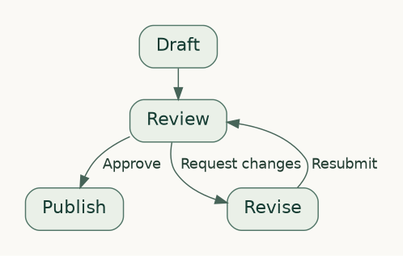

# Build a linked thumbnail

Display the review-cycle image, link the image to the full-size file, and add a text description that explains the return path after a change request.

## Starter

~~~~markdown
[Open the review diagram](../media/review-cycle.png)
~~~~

## Hint

The image syntax goes inside the square brackets of the outer link. Its destination can be the same file.

## Worked solution

~~~~markdown

[Open the full-size review diagram](../media/review-cycle.png). Requested changes send the draft back to the reviewer after editing.
~~~~

## Self-check

The thumbnail displays, both links open the image, and the revision loop makes sense when images are unavailable.
