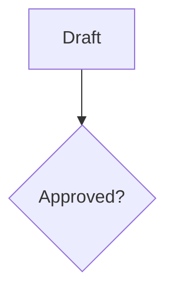
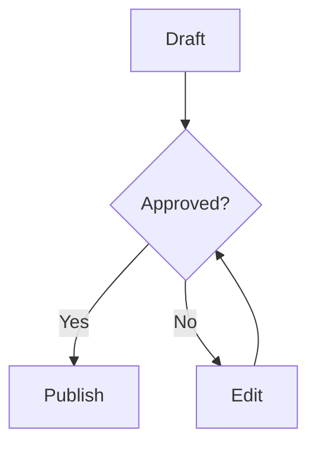

# Diagram both review outcomes

Complete the flowchart so approval publishes the release and a rejected review returns for editing. Describe the loop in one sentence outside the fence.

## Starter

~~~~markdown

~~~~

## Hint

Use a stable ID for each node and put the edge label between pipe characters.

## Worked solution

~~~~markdown
A requested change sends the draft back through review.

~~~~

## Self-check

Trace both paths. The No path loops back to Review, and the Yes path ends at Publish. Switching TD to LR changes the layout and preserves those paths.
