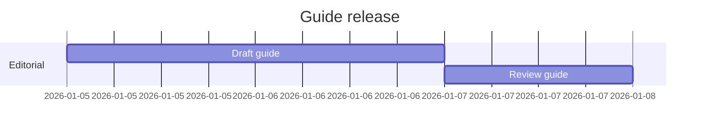

# Express a scheduling dependency

Schedule two days of drafting starting January 5, 2026. Have one day of review begin when drafting ends. Extend the draft to three days and observe the review move.

## Starter

~~~~markdown
```mermaid
gantt
  title Guide release
  dateFormat YYYY-MM-DD
  section Editorial
```
~~~~

## Hint

Give the draft an ID and use “after draft” as the review start.

## Worked solution

~~~~markdown

~~~~

## Self-check

The review starts after the draft bar. Increasing the draft duration shifts the review without editing its start date.
