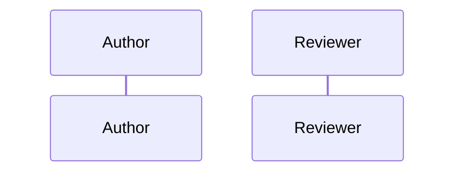
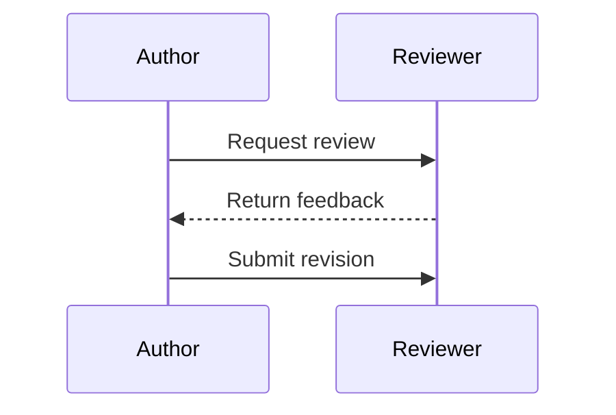

# Trace a review exchange

Declare Author and Reviewer. Send a request, return feedback and send a revision in that order.

## Starter

~~~~markdown

~~~~

## Hint

Read the sender on the left of an arrow and the receiver on its right.

## Worked solution

~~~~markdown

~~~~

## Self-check

The middle message points back to Author. Time progresses downward and the last message returns the revision to Reviewer.
