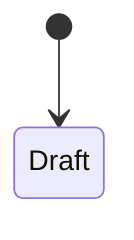
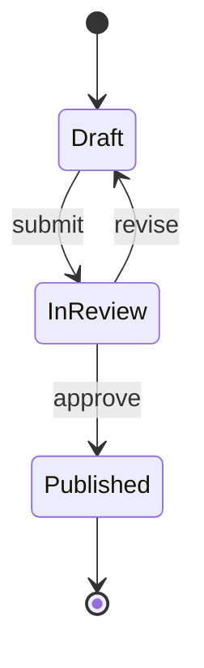

# Define the document lifecycle

Create Draft, InReview and Published states. A revision returns to Draft. Only an approval may lead to Published. Mark the start and the end.

## Starter

~~~~markdown

~~~~

## Hint

Use state names for conditions and edge labels for events.

## Worked solution

~~~~markdown

~~~~

## Self-check

Trace submit, revise, submit, approve. The route visits Draft twice and Published once. There is no direct arrow from Draft to Published.
